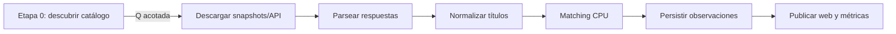

# Pipeline: diseño objetivo y alcance implementado

- **Secuencial:** descarga y matching en una sola secuencia.
- **Concurrente:** workers de hilos solapan la etapa de E/S; matching sigue secuencial.
- **Paralelo completo:** E/S concurrente y matching con procesos (`ProcessPoolExecutor`) para sortear el GIL de Python.
- La implementación de esta versión ya usa una cola de trabajo acotada entre el productor y los consumidores de E/S. `queue_size` aplica backpressure. La cola acotada independiente entre cada una de las seis etapas, el pipeline de producción multi-fuente y la persistencia de fallidos quedan como trabajo pendiente, no como funcionalidad que se afirme terminada.
- No ejecutar benchmark formal contra tiendas vivas. Usar snapshots reales autorizados con `scripts/benchmark_replay.py`.
